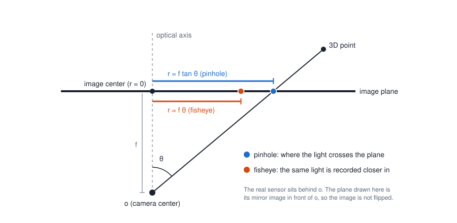
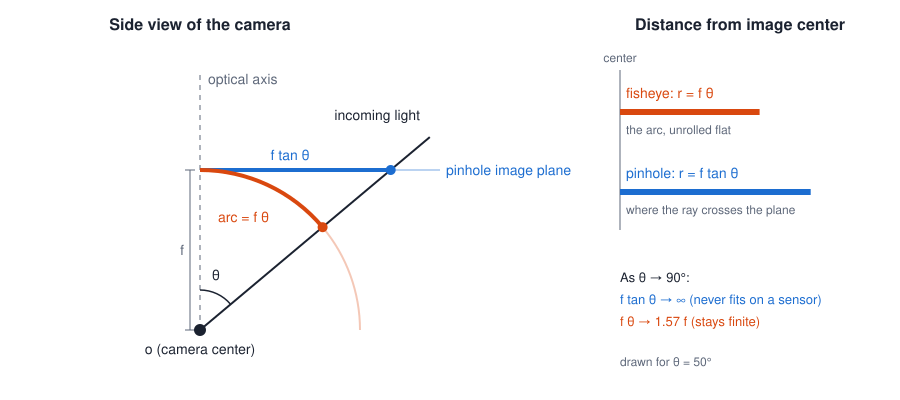
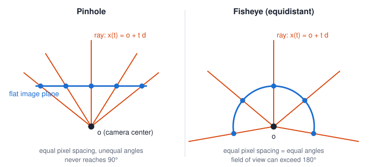
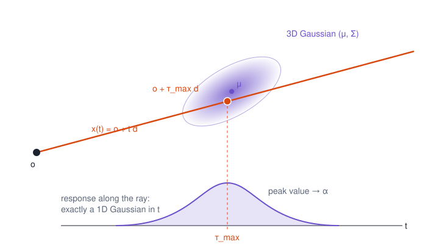

# 3D Gaussian Ray Tracing: Fast Tracing of Particle Scene

# Motivation
To understand this paper, consider how a wall can be represented in a computer. One common and classic approach is to represent its surface using a triangle mesh. Another approach, used in 3D Gaussian Splatting (3DGS), is to represent the scene using many overlapping, semi-transparent 3D Gaussian particles. Intuitively, these particles can be viewed as "fuzzy blobs" with spatial extent, color, and opacity. 3D Gaussian Splatting (3DGS) uses 3D Gaussian particles to represent a scene and render them efficiently through rasterization.

While 3DGS already enables fast, high-quality novel-view synthesis, its rasterization-based renderer is less suited to tasks involving complex camera models or secondary rays for effects such as reflections and refractions. Ray tracing offers greater flexibility for these tasks, but efficiently tracing a scene containing many overlapping, semi-transparent particles is challenging. 3DGRT addresses this challenge by introducing a fast, differentiable ray tracer for particle-based scenes. 

# Background (Prior Knowledgea)
## What is differentiable rendering, and why do we need it?

To understand any vision or graphics, it's important to know the Pinhole camera first. Then how 3D points map into 2D image plane.

To reconstruct a scene from photographs, we adjust the particle mentioned above, so that the rendered images match the reference images. Differentiable rendering allows us to compute gradients of the images reconstruction loss with respect to particle parameters, such as position, shape, color, and opacity.

For example, the gradient with respect to a particle's position tells us how small movements affect the loss. We can then update its position in the negative gradient direction to seek a lower reconstruction error. Repeating this process helps fit the scene to the photograph.

A position update makes your example concrete: 

$$
\mu
\leftarrow
\mu
-\eta\,\nabla_{\mu}\mathcal{L}
$$

Here, $$\mu$$ is the particle's position, $$\mathcal{L}$$ is the image reconstruction loss, and $$\eta$$ is the learning rate. This is a local update direction; a finite step does not always reduce the loss.

## From a pixel to a ray

A camera model is a function that maps a 3D point to a pixel. For a pinhole camera, a point $$(X, Y, Z)$$ in camera coordinates lands at

$$
u = f\frac{X}{Z},\qquad v = f\frac{Y}{Z}
$$

The division by $$Z$$ makes this projection nonlinear. Apart from that division the map is linear, so a pinhole camera still sends straight lines in 3D to straight lines in the image.

A fisheye camera is nonlinear in a stronger sense: it bends straight lines into curves. In the equidistant model, the distance $$r$$ from the image center is proportional to the angle $$\theta$$ between the incoming light and the optical axis:

$$
r = f\,\theta
$$

Here $$r$$ is a distance measured on the image itself: from the image center, where the optical axis meets the sensor, to the point where the light lands. The angle $$\theta$$ lives in 3D, $$r$$ lives on the 2D image, and $$f$$ converts one into the other.



This figure shows the physical layout of a camera. The camera center $$\mathbf{o}$$ is the pinhole or lens that all light passes through, and the sensor sits at distance $$f$$ behind it. Light from above the optical axis lands below it, so the image on the sensor is flipped. The other figures in this post draw a virtual image plane at the same distance in front of $$\mathbf{o}$$ instead, which is the usual convention in graphics and vision: the geometry and every distance $$r$$ are the same, and the image is upright.



Geometrically, $$f\theta$$ is the length of the arc that the angle $$\theta$$ cuts on a circle of radius $$f$$ around the camera center. A fisheye image is that arc unrolled flat. A pinhole camera instead records where the same ray crosses a flat plane at distance $$f$$, which is $$f\tan\theta$$. As $$\theta$$ approaches $$90^\circ$$, $$f\tan\theta$$ grows without bound while $$f\theta$$ stays finite, which is why a fisheye lens can fit a very wide field of view on a sensor.

Written as a function of the 3D point, this becomes

$$
\theta = \arctan\frac{\sqrt{X^2+Y^2}}{Z},\qquad
u = f\,\theta\,\frac{X}{\sqrt{X^2+Y^2}},\qquad
v = f\,\theta\,\frac{Y}{\sqrt{X^2+Y^2}}
$$

On top of a division, the map now contains an arctangent and a square root. Note the contrast in terms of the angle: a pinhole camera gives $$r = f\tan\theta$$, while the fisheye is linear in $$\theta$$. The fisheye is simple as a function of the angle, but more complex as a function of $$(X, Y, Z)$$, and that second function is the one a rasterizer has to approximate. A pinhole camera also cannot represent directions with $$\theta \ge 90^\circ$$ at all, because they have $$Z \le 0$$.

A ray is the inverse of this mapping. For each pixel we ask which 3D line sends light to it:

$$
\mathbf{x}(t) = \mathbf{o} + t\,\mathbf{d}
$$

Here, $$\mathbf{o}$$ is the camera center, $$\mathbf{d}$$ is the direction decided by the pixel, and $$t$$ is the distance along the ray when $$\mathbf{d}$$ is a unit vector.



Two observations matter for the rest of this post. First, no matter how distorted the camera is, we can compute $$\mathbf{d}$$ exactly for every pixel. Second, the ray itself is always a straight line. The complexity of the camera appears only when we build $$\mathbf{d}$$, and it ends there. A rolling-shutter camera fits the same picture: each image row is captured at a different time, so each row simply gets its own $$\mathbf{o}$$ and $$\mathbf{d}$$.

## A Gaussian along a ray

A 3D Gaussian particle with mean $$\mu$$ and covariance $$\Sigma$$ has the response

$$
G(\mathbf{x}) = \exp\!\left(-\tfrac{1}{2}(\mathbf{x}-\mu)^\top \Sigma^{-1} (\mathbf{x}-\mu)\right),
\qquad \Sigma = R\,S\,S^\top R^\top
$$

where $$R$$ is a rotation and $$S$$ is a diagonal scale matrix. Its level sets are ellipsoids, so a particle is a fuzzy ellipsoid that is dense at the center and fades outward.

**What 3DGS does.** A rasterizer needs a 2D Gaussian on the image. A Gaussian stays a Gaussian only under a linear map, but the projection $$\pi$$ is nonlinear. So 3DGS replaces the projection with its first-order Taylor expansion around the particle center, $$\pi(\mathbf{x}) \approx \pi(\mu) + J(\mathbf{x}-\mu)$$, which gives

$$
\Sigma_{2D} = J\,W\,\Sigma\,W^\top J^\top
$$

where $$W$$ is the world-to-camera rotation and $$J$$ is the Jacobian of the projection. This is a tangent-line approximation. It gets worse when the particle is large or when the projection bends strongly, which is exactly the case for fisheye lenses and wide fields of view. With a rolling shutter there is not even a single projection function for the whole image.

**What 3DGRT does.** 3DGRT never projects the particle. It substitutes the ray into the 3D Gaussian instead. Because the ray is linear in $$t$$, the exponent becomes a quadratic in $$t$$:

$$
q(t) = (\mathbf{o} + t\mathbf{d} - \mu)^\top \Sigma^{-1} (\mathbf{o} + t\mathbf{d} - \mu)
$$

So the response along the ray is exactly a 1D Gaussian in $$t$$, with no approximation. Setting $$dq/dt = 0$$ gives the point where the response is largest:

$$
\tau_{\max} = \frac{(\mu - \mathbf{o})^\top \Sigma^{-1}\mathbf{d}}{\mathbf{d}^\top \Sigma^{-1}\mathbf{d}}
$$



Here $$\tau_{\max}$$ is a scalar: the ray parameter at which the particle responds most strongly. The 3D location is $$\mathbf{o} + \tau_{\max}\mathbf{d}$$. There are three useful ways to read it.

1. It is the mean of the 1D Gaussian that the ray sees:

   $$
   G(\mathbf{o} + t\mathbf{d}) = G(\mathbf{o} + \tau_{\max}\mathbf{d})\cdot \exp\!\left(-\tfrac{1}{2}\,(\mathbf{d}^\top\Sigma^{-1}\mathbf{d})\,(t-\tau_{\max})^2\right)
   $$

2. It is the point on the ray closest to $$\mu$$ in Mahalanobis distance. This differs from the Euclidean closest point unless the particle is a sphere.
3. If we move to the particle's canonical space, $$\mathbf{o}_g = S^{-1}R^\top(\mathbf{o}-\mu)$$ and $$\mathbf{d}_g = S^{-1}R^\top\mathbf{d}$$, the particle becomes a unit sphere at the origin and $$\tau_{\max} = -\mathbf{o}_g^\top\mathbf{d}_g \,/\, \mathbf{d}_g^\top\mathbf{d}_g$$. This is just the foot of the perpendicular from the origin to the line.

Two things $$\tau_{\max}$$ is not. It is not the point where the ray hits the bounding mesh of the particle (introduced below); that hit only tells us the particle is a candidate. And it is not an integral of the density along the ray; 3DGRT uses the single peak value.

## Compositing particles along a ray

Once the particles on a ray are ordered from near to far, the pixel color is the standard volume rendering sum:

$$
C = \sum_i c_i\,\alpha_i\,T_i,\qquad T_i = \prod_{j<i}(1-\alpha_j)
$$

Here $$T_i$$ is the transmittance, the fraction of light that survives the particles in front of particle $$i$$. In 3DGRT the opacity of a particle on this ray is its opacity coefficient $$\sigma_i$$ times the peak response:

$$
\alpha_i = \sigma_i\, G_i(\mathbf{o} + \tau_{\max}\mathbf{d})
$$

The sum must be evaluated front to back. A rasterizer gets this order from a global sort. A ray tracer has to find it per ray, and that is the core difficulty of the paper.

# Abstract Analysis

# Method: The Core Algorithm

## Why this is hard

Hardware ray tracing is built for opaque triangles: a ray wants its single closest hit, and the BVH traversal can stop early. A particle scene breaks both assumptions. A ray passes through tens to hundreds of overlapping, semi-transparent particles, and it needs all of them, in depth order, until the transmittance runs out. 3DGRT solves this with two ideas: a bounding mesh that lets the hardware do the intersection work, and a k-buffer that collects hits in ordered chunks.

## 1. Bounding each particle with a stretched icosahedron

GPU ray tracing hardware accelerates ray–triangle tests, while custom intersection programs are much slower. So instead of intersecting the Gaussian directly, 3DGRT wraps every particle in an icosahedron (20 triangles) that is stretched to follow the particle's shape, and builds a BVH over these triangles. A hit on the mesh only means "this particle may contribute to this ray."

The mesh is sized by opacity. A particle only matters where its response exceeds a minimum $$\alpha_{\min}$$, so each unit-icosahedron vertex $$\mathbf{v}$$ is placed at

$$
\mathbf{v} \leftarrow \sqrt{2\log(\sigma/\alpha_{\min})}\; R\,S\,\mathbf{v} + \mu
$$

A faint particle gets a small mesh, so rays do not waste time on hits that would contribute nothing.

## 2. Collecting hits with a k-buffer

Storing every hit on a ray would cost too much memory, and tracing one closest hit at a time would restart the BVH traversal too often. 3DGRT takes the middle path: each traversal returns the next $$k$$ closest hits.

```
T = 1, C = 0, t_start = 0
while T > T_min:
    # one BVH traversal; the any-hit program keeps a sorted buffer of the k nearest hits
    hits = trace_k_closest(ray, t_min = t_start)
    if hits is empty: break

    for h in hits (near to far):
        tau   = argmax_t G_h(o + t d)          # closed form, see above
        alpha = sigma_h * G_h(o + tau d)
        if alpha < alpha_min: continue
        C += T * alpha * c_h(d)                # color from spherical harmonics, evaluated with the ray direction
        T *= (1 - alpha)
        if T < T_min: break

    t_start = distance of the last hit in the buffer
```

Inside one traversal, the any-hit program inserts each new hit into the sorted buffer. If the hit is closer than the farthest entry, it replaces that entry and the traversal continues; the ray is not allowed to stop at the first hit. After the traversal, the $$k$$ particles are blended, and the ray is traced again starting from the last hit. The loop ends when the transmittance falls below a threshold or the ray leaves the scene.

The choice of $$k$$ is a trade-off. A small $$k$$ means many traversals per ray. A large $$k$$ means a more expensive any-hit program and wasted work when the ray terminates early.

## 3. Backward pass

The forward pass does not store the per-ray hit lists. To compute gradients, 3DGRT traces the same rays again, visits the same particles in the same order, and accumulates the gradients of the loss with respect to each particle's position, shape, opacity, and color as it goes. The BVH is rebuilt or updated during training because the particles move and are densified.

## What the ray formulation buys

Since everything is defined per ray, anything that can be written as a ray works without changing the scene representation: distorted cameras and rolling shutter, secondary rays for reflection, refraction, and shadows, mixing particles with triangle meshes in one scene, and stochastic sampling such as depth of field.

